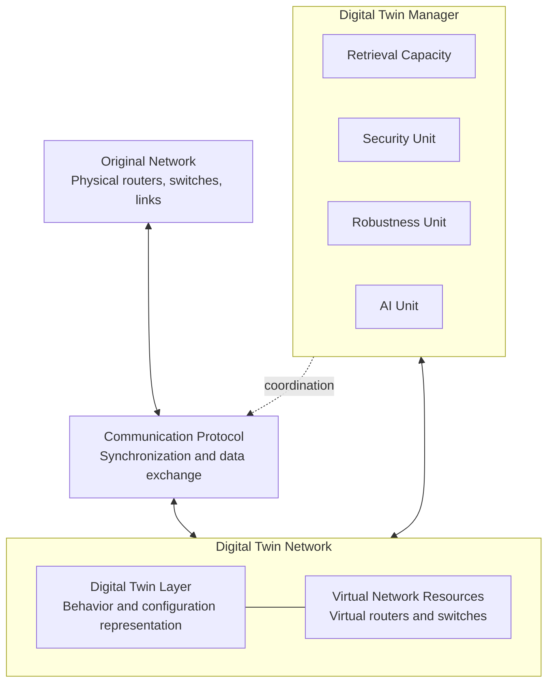

# Virtual Network Twin (VNT) — Architecture and Research

**A research-based overview of the Virtual Network Twin architecture proposed by Amir Hossein Banisadr and Xavier Hesselbach.**

**Publication:** Banisadr, A. H., & Hesselbach, X. (2024). *A Novel Architecture for Virtual Network Twin Deployment*. Electronics, 13(24), 5045. https://doi.org/10.3390/electronics13245045

**Research affiliation:** Department of Network Engineering, Universitat Politècnica de Catalunya (UPC), Barcelona, Spain.

> **Status:** Published architectural research and technical documentation. This repository does not claim to contain a deployed VNT system, validated simulator, or experimental performance results.

## Research motivation

The proposed Virtual Network Twin (VNT) combines **network virtualization** and **digital twin** concepts to investigate how a virtualized network replica can represent the configuration and behavior of an original network while supporting synchronized connectivity. The architecture emphasizes visibility, security, robustness, communication requirements, and accuracy evaluation.

## Architecture overview



*Conceptual redraw of the components described in Section 3.1 and Figure 2 of the published article; not a reproduction of the original figure. Connections simplify the paper's conceptual framework.*

## Core components

| Component | Role in the proposed architecture |
| --- | --- |
| **Original Network** | Physical devices and links supporting network communications. |
| **Digital Twin Network (DTN)** | Virtualized representation of the original network, with a digital twin layer and virtual network resources. |
| **Digital Twin Manager** | Coordinates and maintains the VNT through dedicated functional units. |
| **Retrieval Capacity** | Retrieves real-time network data and responds to twin requests. |
| **Security Unit** | Addresses unauthorized access and attacks. |
| **Robustness Unit** | Supports resilience under failures or attacks. |
| **AI Unit** | Proposed to optimize the operation of VNT components. |
| **Communication Protocol** | Enables information exchange and synchronization between original and virtual networks. |

## Network modeling and scalability

The article proposes **adjacency matrices** as an initial topology representation. It discusses the practical trade-offs across small networks (tens of nodes), medium networks (hundreds of nodes), and very large networks (millions of nodes). The dense adjacency-matrix representation becomes less practical as network size grows, motivating future investigation of scalable alternatives.

## Evaluation considerations

The paper identifies VNT accuracy and synchronization as central research challenges and discusses performance indicators such as **latency, throughput, and error rates**. Communication protocol requirements include low latency, reliability, scalability, security, and interoperability. These are **proposed assessment dimensions**, not measured benchmark results in this repository.

## Scope and future work

This repository currently documents the **2024 published architecture**. Future additions may include independently developed topology examples, reproducible simulations, and accuracy-measurement experiments, clearly labeled when available. Later research directions should not be interpreted as completed contributions of the 2024 publication.

## Read the paper

- [Published article (DOI)](https://doi.org/10.3390/electronics13245045)
- [Author's GitHub profile](https://github.com/amirhosseinbanisadr1985-hash)

## Citation

```bibtex
@article{banisadr2024vnt,
  title={A Novel Architecture for Virtual Network Twin Deployment},
  author={Banisadr, Amir Hossein and Hesselbach, Xavier},
  journal={Electronics},
  volume={13},
  number={24},
  pages={5045},
  year={2024},
  doi={10.3390/electronics13245045}
}
```

## License and attribution

The linked article is published under **CC BY 4.0**. This README is a new explanatory summary and conceptual redraw based on the cited article. Cite the original paper when using its architectural ideas.
